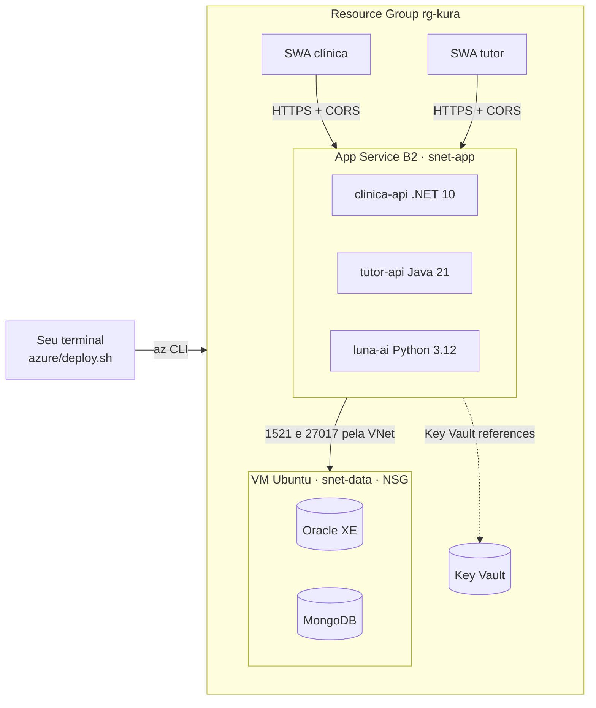

# Kura — DevOps-Cloud

Provisiona e implanta o Kura no **Azure** por linha de comando: **App Service** (as 3 APIs), **Oracle e MongoDB em
containers numa VM**, **Key Vault** (segredos) e **Static Web Apps** (web dos apps React Native).
Todos os comandos Azure estão em [`azure/deploy.sh`](azure/deploy.sh); este repositório cobre o **deploy inicial** dos
5 serviços (3 APIs e 2 apps web).



## Índice

- [O que este repositório entrega](#o-que-este-repositório-entrega)
- [Pré-requisitos](#pré-requisitos)
- [Passo a passo do deploy inicial](#passo-a-passo-do-deploy-inicial)
  - [Passo 1: Baixar o repositório e os submódulos](#passo-1-baixar-o-repositório-e-os-submódulos)
  - [Passo 2: Entrar no Azure e conferir os pré-requisitos](#passo-2-entrar-no-azure-e-conferir-os-pré-requisitos)
  - [Passo 3: Ajustar a configuração (opcional)](#passo-3-ajustar-a-configuração-opcional)
  - [Passo 4: Criar a infraestrutura](#passo-4-criar-a-infraestrutura)
  - [Passo 5: Compilar as APIs](#passo-5-compilar-as-apis)
  - [Passo 6: Implantar as APIs](#passo-6-implantar-as-apis)
  - [Passo 7: Compilar e publicar os apps web](#passo-7-compilar-e-publicar-os-apps-web)
  - [Passo 8: Conferir o resultado](#passo-8-conferir-o-resultado)
- [Atalho: tudo de uma vez](#atalho-tudo-de-uma-vez)
- [Atualizar uma versão depois do deploy inicial](#atualizar-uma-versão-depois-do-deploy-inicial)
- [Configuração](#configuração)
- [Segredos (Key Vault)](#segredos-key-vault)
- [Operação](#operação)
- [Evidência no banco por SELECT](#evidência-no-banco-por-select)
- [Packages do banco (Sprint 4)](#packages-do-banco-sprint-4)
- [Seeds e smoke](#seeds-e-smoke)
- [CI no GitHub Actions](#ci-no-github-actions)
- [Solução de problemas](#solução-de-problemas)
- [Remover o ambiente](#remover-o-ambiente)

## O que este repositório entrega

| Caminho | Para quê |
|---|---|
| `azure/deploy.sh` | Todos os comandos `az`: fases `check`, `infra`, `build`, `apps`, `web`, `urls`, `seed`, `db-packages`, `db-packages-remover`, `all` e `destroy` |
| `azure/staticwebapp.config.json` | Fallback de SPA, cache e headers dos 2 Static Web Apps |
| `mongo/init/` | Role/usuário do Java no MongoDB (enviado à VM pelo `deploy.sh`) |
| `scripts/` | Seeds de demonstração, `preflight-next.sh`, `smoke-contratos.sh` (ver [Seeds e smoke](#seeds-e-smoke)) e `db-select.sh` (SELECT no Oracle sem expor a senha; ver [Evidência no banco por SELECT](#evidência-no-banco-por-select)) |
| `docs/ARQUITETURA.md` | Arquitetura, rede, segredos e decisões |
| `.github/workflows/ci.yml` | CI: valida os scripts e confere se os submódulos estão no `main` mais recente |
| `.gitmodules` | 5 submódulos: 3 APIs e 2 apps RN. **O SHA gravado é a versão que o `build` compila** |
| `.gitattributes` | Força LF (os scripts rodam em bash: Git Bash, Linux ou macOS) |

## Pré-requisitos

Os scripts são **bash**. No Windows use o **Git Bash** (vem com o Git for Windows); **WSL não é necessário**. Linux e macOS
funcionam direto. Instale, em qualquer sistema:

| Ferramenta | Usada em | Observação |
|---|---|---|
| Git (no Windows: **Git for Windows**, que traz o Git Bash), `curl`, Python 3 | todas as fases | No Windows, o Python vem do instalador oficial ou de `winget install Python.Python.3.12`; o atalho `python3` da Microsoft Store não serve |
| Azure CLI (`az`) | todas as fases | recente; o `deploy.sh` foi conferido contra a 2.91 |
| .NET SDK 10 e JDK 21 | `build` | o script confere as versões; `zip` é opcional (sem ele o script usa o Python) |
| Node.js (`npm`, `npx`) | `web` | exige 20 ou superior; validado com a 22 LTS |

A fase `check` confere tudo isso (e o login, os submódulos e os runtimes) sem criar nada: rode-a antes do primeiro deploy
([Passo 2](#passo-2-entrar-no-azure-e-conferir-os-pré-requisitos)).

Na subscription, a identidade que executa precisa de **Owner**, ou **Contributor + User Access Administrator**: o
`deploy.sh` concede papéis do Key Vault às identidades dos Web Apps e da VM. Confirme também que a região escolhida tem
cota para o plano **B2** do App Service e para uma VM de 2 vCPU e 8 GiB (o script testa alguns tamanhos e zonas).

## Passo a passo do deploy inicial

Rode tudo a partir da raiz do repositório. Cada fase pode ser repetida: o script só cria o que ainda não existe.

### Passo 1: Baixar o repositório e os submódulos

Abra o **Git Bash** (Windows) ou um terminal bash e rode todos os comandos deste guia nele.

```bash
git clone --recurse-submodules <url-do-repositório>
cd DevOps-Cloud
# se já clonou sem submódulos:
git submodule update --init --recursive
```

Confira que as pastas `dotnet-backend`, `java-backend`, `luna-ia`, `mobile-clinica-rn` e `mobile-tutor-rn` têm
conteúdo. Vazias, as fases `build` e `web` param com a mensagem pedindo esse comando.

### Passo 2: Entrar no Azure e conferir os pré-requisitos

```bash
az login                                   # sem navegador no terminal: az login --use-device-code
az account set --subscription <id-ou-nome>
az account show -o table                   # confirme a subscription ativa
bash azure/deploy.sh check                 # confere ferramentas, login, submódulos e runtimes; não cria nada
```

Cada linha do `check` aparece como `PASSOU` ou `FALHOU`; corrija as pendências e repita até aparecer `tudo pronto para o deploy`.
Com várias subscriptions, `AZURE_SUBSCRIPTION=<id ou nome>` escolhe a que o script usa.

### Passo 3: Ajustar a configuração (opcional)

Os padrões funcionam (região `eastus2`, prefixo `kura`, grupo `rg-kura`). Para mudar algo, exporte a variável **antes
de cada fase** (ver [Configuração](#configuração)). Para fornecer os segredos externos da Luna e do .NET, exporte também
(eles são gravados no Key Vault e nunca impressos):

```bash
export LOCATION=eastus2
export TWILIO_SID=...  TWILIO_TOKEN=...  OPENAI_API_KEY=...  DAILY_API_KEY=...   # todos opcionais
```

> Variáveis que mudam nomes ou o banco (`PREFIX`, `RG`, `LOCATION`, `ORACLE_IMAGE`, `ORACLE_SERVICE`…) precisam ter o
> **mesmo valor em todas as fases**. O `export` vale só para o terminal em que foi digitado: mantenha todas as fases no mesmo Git Bash.

### Passo 4: Criar a infraestrutura

```bash
bash azure/deploy.sh infra
```

Cria, em 6 etapas numeradas: grupo de recursos, NSG/VNet/sub-redes, Key Vault e segredos, VM do banco (Oracle XE 21c +
MongoDB em containers), plano e os 3 Web Apps, e os 2 Static Web Apps. É a fase mais demorada: a VM baixa as imagens e o
Oracle cria o banco na primeira subida (o script espera até 30 minutos). Termina com `banco pronto em 10.20.2.x` e a
lista de URLs. Antes das 6 etapas, o script registra os providers da subscription que ainda não estiverem registrados e,
sem `VM_SIZE`, testa tamanhos e zonas de VM até achar um disponível na sua conta.

### Passo 5: Compilar as APIs

```bash
bash azure/deploy.sh build
```

Compila, a partir dos submódulos, `clinica.zip` (.NET), `tutor.jar` (Java, sem rodar testes: eles rodam no CI do repo da
API) e `luna.zip` (Python) em `artifacts/`, e lista os arquivos ao final. O Maven vem do `mvnw`; se ele não conseguir preparar o
Maven (no Git Bash falta o `unzip`), o script usa o `mvn` do PATH ou baixa o Maven sozinho.

### Passo 6: Implantar as APIs

```bash
bash azure/deploy.sh apps
```

Grava os app settings (referências ao Key Vault) e implanta na ordem **tutor → clínica e Luna**: o Flyway do tutor cria o
schema Oracle ao subir, e o script só segue depois que `/api/actuator/health` responde 200. Em seguida espera a clínica
e a Luna (`/health`). Se alguma não ficar saudável, o script mostra o log do Web App e para.

### Passo 7: Compilar e publicar os apps web

```bash
bash azure/deploy.sh web
```

Compila os 2 apps Expo com as **URLs reais das APIs embutidas no JavaScript** (por isso vem depois do passo 6), em
`web-dist/`, e publica cada um no seu Static Web App.

### Passo 8: Conferir o resultado

```bash
eval "$(bash azure/deploy.sh urls)"      # define CLINICA_API_URL, TUTOR_API_URL, LUNA_URL, CLINICA_WEB_URL, TUTOR_WEB_URL
curl -s -o /dev/null -w 'clinica %{http_code}\n' "$CLINICA_API_URL/health"
curl -s -o /dev/null -w 'tutor   %{http_code}\n' "$TUTOR_API_URL/api/actuator/health"
curl -s -o /dev/null -w 'luna    %{http_code}\n' "$LUNA_URL/health"
echo "$CLINICA_WEB_URL  $TUTOR_WEB_URL"   # abra os dois no navegador
```

Esperado: `200` nas três APIs e os dois apps web abrindo. Depois, no portal: cada Web App → *Settings* →
*Environment variables* (antes chamada *Configuration*) deve mostrar as referências do Key Vault resolvidas (ícone verde;
podem levar alguns minutos após os papéis). Para popular dados de demonstração, ver [Seeds e smoke](#seeds-e-smoke).

## Atalho: tudo de uma vez

```bash
bash azure/deploy.sh all      # check → infra → build → apps → web (passos 4 a 7)
```

## Atualizar uma versão depois do deploy inicial

O `build` compila o commit que cada submódulo tem fixado. Para publicar uma versão nova de uma API ou app:

```bash
git submodule update --remote java-backend         # ou dotnet-backend, luna-ia, mobile-*-rn
bash azure/deploy.sh build && bash azure/deploy.sh apps      # APIs
bash azure/deploy.sh web                                     # apps web
git add java-backend && git commit -m "chore: atualiza java-backend"   # registra o que foi implantado
```

Rollback: volte o submódulo ao commit anterior (`git -C java-backend checkout <sha>`) e repita as fases. A pipeline de
CI/CD do Azure DevOps do `tutor-api` fica no repositório do Java, não aqui.

## Configuração

Tudo é sobrescrevível por variável de ambiente (valores padrão entre parênteses).

| Variável | Para quê |
|---|---|
| `LOCATION` (`eastus2`), `SWA_LOCATION` (= `LOCATION`) | Região; troque `SWA_LOCATION` se a região não oferecer Static Web Apps |
| `PREFIX` (`kura`), `RG` (`rg-$PREFIX`) | Prefixo dos nomes e grupo de recursos |
| `NAME_SUFFIX`, `KV_NAME` | Sufixo/nome do Key Vault (padrão: hash estável da subscription; o nome é global) |
| `VM_SIZE` (vazio = automático), `VM_SIZE_CANDIDATOS`, `VM_ZONE`, `VM_IMAGE` (Ubuntu 24.04) | VM do banco: sem `VM_SIZE`, o script testa os candidatos (2 vCPU, 8 GiB) e as zonas com `az vm create --validate`; `VM_ZONE=1\|2\|3` fixa a zona e `VM_ZONE=` vazio força "sem zona" |
| `AZURE_SUBSCRIPTION` | Subscription usada (id ou nome), quando há várias |
| `KURA_TOOLS` (`~/.kura-tools`) | Onde o script guarda o Maven que baixar, se o `mvnw` falhar |
| `ORACLE_IMAGE` (`gvenzl/oracle-xe:21-slim`), `ORACLE_SERVICE` (`XEPDB1`), `ORACLE_APP_USER` (`KURA`) | Banco. O 26ai Free (`gvenzl/oracle-free:slim` + `FREEPDB1`) ainda não foi validado com o Flyway do tutor |
| `PLAN_SKU` (`B2`) | Plano do App Service |
| `RUNTIME_DOTNET` (`DOTNETCORE:10.0`), `RUNTIME_JAVA` (`JAVA:21-java21`), `RUNTIME_PYTHON` (`PYTHON:3.12`) | Runtimes (o script confere com `az webapp list-runtimes`) |
| `EXTRA_CORS_ORIGINS` | Origens extras no CORS (ex.: `http://localhost:19006`) |
| `LOJA_SEED_EXEMPLO` (`true`) | Catálogo de exemplo da Loja |
| `LUNA_SCHEDULER_ENABLED` (`false`), `LEMBRETE_CONFIRMACAO_HABILITADO` (`false`) | Agendadores da Luna |
| `ARTIFACTS_DIR` (`./artifacts`), `WEB_DIR` (`./web-dist`) | Saída do `build` e do build web |
| `CONFIRMA=sim` | Exigida pelo `destroy` |
| `DEMO_SENHA`, `DEMO_WHATSAPP` / `SEED_SEM_WHATSAPP=1` | Exigidas pelo `seed` (ver [Seeds e smoke](#seeds-e-smoke)) |

As demais (`TWILIO_FROM_NUMBER`, `JWT_ACCESS_EXPIRATION_MINUTES`, `STORAGE_BASE_PATH`…) estão no bloco *Configuração* do
`deploy.sh`.

## Segredos (Key Vault)

Gerados na primeira execução e nunca impressos. Para fornecer um valor, exporte a variável antes do `deploy.sh`.

| Segredo | Usado por | Origem |
|---|---|---|
| `oracle-sys-password`, `oracle-app-password` | VM, tutor, Luna, .NET | gerado |
| `dotnet-oracle-connection-string` | clinica-api | composto pelo script |
| `dotnet-jwt-key`, `java-jwt-secret`, `foto-url-secret` | .NET, Java | gerado |
| `iot-api-key`, `luna-api-key`, `luna-inbound-api-key` | .NET ↔ Luna, dispositivos | gerado |
| `mongo-root-password`, `mongo-java-password`, `mongo-dotnet-password`, `tutor-mongodb-uri`, `dotnet-mongodb-uri` | VM, tutor, clínica | gerado / composto |
| `twilio-sid`, `twilio-token`, `openai-api-key`, `daily-api-key` | Luna, .NET | **você fornece** (opcionais) |

Trocar uma senha de banco **depois** da primeira subida exige alterar também o usuário dentro do banco: o container só
aplica a senha ao criar o volume.

## Operação

```bash
# containers do banco
az vm run-command invoke -g rg-kura -n vm-kura-db --command-id RunShellScript \
  --scripts "docker ps --format '{{.Names}}  {{.Status}}'" --query 'value[0].message' -o tsv
# reiniciar o Oracle
az vm run-command invoke -g rg-kura -n vm-kura-db --command-id RunShellScript --scripts "docker restart kura_oracle_db"
# logs de um Web App
az webapp log tail -g rg-kura -n kura-tutor-api
# cópia do disco da VM (crash-consistent; não há backup automático)
az snapshot create -g rg-kura -n snap-db-$(date +%F) \
  --source "$(az vm show -g rg-kura -n vm-kura-db --query storageProfile.osDisk.managedDisk.id -o tsv | tr -d '\r')"
```

Não há SSH: o NSG nega toda entrada além de Oracle/MongoDB vindos da sub-rede dos Web Apps.

## Evidência no banco por SELECT

Para comprovar uma operação do CRUD (INSERT, UPDATE ou DELETE feitos pela aplicação) com um SELECT dentro do banco, sem SSH e
sem a senha aparecer na tela (útil para gravar o vídeo):

```bash
bash scripts/db-select.sh --tabelas                 # tabelas do schema
bash scripts/db-select.sh --colunas PET             # colunas de uma tabela
bash scripts/db-select.sh "select * from tutor"     # um SELECT qualquer
bash scripts/db-select.sh -f consulta.sql           # SELECT guardado em arquivo
```

O script aciona a VM com `az vm run-command`; lá dentro ele lê a senha do Key Vault com a identidade gerenciada da VM e
abre o `sqlplus` no container do Oracle. A transação é **somente leitura**: INSERT, UPDATE e DELETE são recusados pelo próprio
banco (`ORA-01456`), e o script só aceita um `SELECT` (ou `WITH`) por vez. Cada consulta leva alguns segundos. Se aparecer
`ORA-` ou `SP2-`, o script termina com erro e mostra a mensagem do Oracle. Usa `PREFIX`, `RG`, `VM_NAME`, `ORACLE_SERVICE`,
`ORACLE_APP_USER` e `KV_NAME` com os mesmos padrões do `deploy.sh`.

## Packages do banco (Sprint 4)

Instala (ou remove) os packages PL/SQL do schema `KURA` no Oracle da VM, por **uma** chamada `az vm run-command`:

```bash
azure/deploy.sh db-packages                       # instala PKG_KURA_LOG, PKG_TRIAGEM, PKG_COBRANCA, PKG_AUDITORIA e a trigger
CONFIRMA=sim azure/deploy.sh db-packages-remover  # saída de emergência: remove a trigger e os 4 packages
```

- **Pré-requisito:** o repo `Mastering-Relational-Database` clonado ao lado deste (não é submódulo). O script lê
  `../Mastering-Relational-Database/src/2TDSPF_2026_Packages_Integrantes.sql` (e `..._Remover.sql`); outra pasta:
  `DB_PACKAGES_SQL_DIR=<pasta src>`. Antes de enviar, imprime o `sha256` do arquivo e o commit dele.
- **O que a fase faz:** o `.sql` vai embutido (gzip + base64) no script da VM, que confere o `sha256`, copia para o container
  `kura_oracle_db`, lê a senha do schema no Key Vault pela identidade da VM e roda o `sqlplus` com a senha **só por stdin**.
  O arquivo da Sprint 3 (`2TDSPF_2026_CodigoSql_Integrantes.sql`, cujo BLOCO 1 derruba as 30 tabelas) **nunca** é enviado: a fase
  recusa, antes de qualquer chamada, qualquer arquivo com `DROP TABLE`, `DROP USER` ou `TRUNCATE TABLE`.
- **O que a sentinela prova:** o `run-command` devolve só os últimos 4.096 bytes e seu código de saída não é confiável, então a
  decisão é uma linha exata (`KURA_DB_PACKAGES_OK` ou `KURA_DB_PACKAGES_REMOVIDO_OK`) que o **próprio script da VM** imprime por
  último, **depois** de ler o log inteiro. Instalar: `sqlplus` com `EXIT=0`, nenhum `ORA-`/`SP2-` fora das regiões
  `DEMO S4-DB-0x: INICIO … FIM`, as 2 demonstrações abertas e fechadas, as 2 linhas `RESUMO: n OK, 0 FALHOU`, nenhum objeto
  inválido no schema, os 9 objetos (4 specs, 4 bodies e a trigger) `VALID` e a senha ausente do log. Remover: `EXIT=0`, nenhum
  `ORA-`, os 5 objetos ausentes de `user_objects` e a senha ausente do log.
- **Log na VM:** `/opt/kura/logs/db-packages-AAAAMMDD-HHMMSS.log` (`db-packages-remover-…` no remover), modo `600`. Para ler,
  um segundo run-command, por exemplo `az vm run-command invoke -g rg-kura -n vm-kura-db --command-id RunShellScript --scripts 'tail -n 80 $(ls -t /opt/kura/logs/db-packages-*.log | head -n 1)'`.
- **Efeitos colaterais da demonstração:** a instalação roda a demonstração embutida no `.sql`, que grava cerca de 6 linhas
  sintéticas em `LOG_ERRO` por execução e consome valores de sequence (`COBRANCA` e `AUDITORIA_COBRANCA` ficam como estavam).
  Ela pressupõe que **nenhuma outra sessão** grave em `COBRANCA` durante a execução: combine uma **janela** antes de rodar
  num ambiente com uso.
- **`db-packages-remover` derruba o financeiro:** sem os packages, a API da clínica (.NET) devolve `503` na exportação JSON e no
  relatório Oracle. Por isso exige `CONFIRMA=sim`. Tabelas, sequences e a trilha de auditoria já gravada não são tocadas.
- **Chamadas à Azure:** cada fase faz **1** `az vm run-command invoke`, mais as chamadas `az account show` do carregamento do
  script e da checagem de ferramentas (2 no teste com o `az` falso, sem `NAME_SUFFIX`/`AZURE_SUBSCRIPTION`).
- **Testes sem Azure e sem Oracle:** `bash azure/tests/db-packages.test.sh` (az, docker, curl e python3 falsos; roda o script
  da VM localmente contra logs-fixture). O que **não** foi exercitado: execução contra Oracle real (local ou na VM), o limite
  de tamanho de entrada do `run-command` e o `az` real no Windows com o arquivo gerado.

## Seeds e smoke

Populam e verificam as APIs **por HTTP real**. Com a stack no ar (`apps` concluído), a fase `seed` descobre as URLs, lê a
chave da Luna no Key Vault e roda `seed-demo.sh`, `seed-demo-luna.sh`, `seed-demo-fotos.sh` e `seed-demo-contas.sh`:

```bash
export DEMO_SENHA='<senha própria da clínica demo>'    # obrigatória: as APIs do Azure são públicas
export DEMO_WHATSAPP='<DDI+DDD+número>'                # ou SEED_SEM_WHATSAPP=1 para dispensar o lembrete por WhatsApp
bash azure/deploy.sh seed
```

O `seed-demo.sh` não é idempotente: se a clínica demo já existe, ele falha de propósito.

| Script | Função |
|---|---|
| `seed-demo.sh`, `seed-demo-luna.sh` | clínica de demonstração e dados da Luna |
| `seed-demo-contas.sh`, `seed-demo-fotos.sh` | contas de tutor do estande e fotos dos pets (`scripts/assets/pets`) |
| `preflight-next.sh` | pré-voo do estande (login, fotos, catálogo da Loja) |
| `smoke-contratos.sh` | contrato app ↔ API |
| `lib-env.sh` | leitura tolerante de chaves (variável de ambiente ou `.env`) |

Os blocos que usam `docker exec` ou conferem containers `kura_*` só valem para uma stack local; os demais passos são HTTP e
funcionam contra o Azure.

## CI no GitHub Actions

`.github/workflows/ci.yml` roda a cada push/PR no `main`, toda segunda-feira e sob demanda:

| Job | O que confere |
|---|---|
| *Validate scripts and embedded compose* | `bash -n` do `deploy.sh` e de `scripts/`, `shellcheck` do `deploy.sh` e do `db-select.sh`; JSON do Static Web Apps; sintaxe do script de bootstrap da VM gerado pelo `deploy.sh`; estrutura do `docker-compose.yml` embutido (YAML válido, variáveis todas definidas no `.env`, sem valores padrão de segredo), tudo sem Docker e sem Azure |
| *Check submodule pins against upstream main* | Falha se algum dos 5 submódulos estiver fixado num commit diferente do `main` do repositório de origem |

## Solução de problemas

| Sintoma | O que fazer |
|---|---|
| `runtime '...' indisponível` | O script lista as opções da região; exporte `RUNTIME_DOTNET`, `RUNTIME_JAVA` ou `RUNTIME_PYTHON` com uma delas |
| `sem sessão Azure` | `az login` e `az account set --subscription <id>` |
| `bootstrap da VM não concluiu (sentinela ausente)` | Repita `bash azure/deploy.sh infra` (é idempotente). Para ver o que houve: `az vm run-command invoke … --scripts "docker logs --tail 40 kura_oracle_db"` |
| Erros de permissão (RBAC) ao gravar segredos | O papel recém-concedido leva minutos para propagar; o script já repete a operação. Se persistir, confira Owner (ou Contributor + User Access Administrator) |
| `build`: `'dotnet' não encontrado`, `JDK 21 ou superior necessário`, `dotnet SDK 10 não encontrado` | Instale a ferramenta indicada (ver [Pré-requisitos](#pré-requisitos)) |
| `... não encontrado: baixe os submódulos` | `git submodule update --init --recursive` |
| `tutor-api não ficou saudável` | O log do Web App é impresso; confira o banco (`az vm run-command` acima) e as referências do Key Vault |
| Referência do Key Vault não resolvida | Aguarde alguns minutos após os papéis; reinicie o Web App (`az webapp restart -g rg-kura -n <app>`) |
| Região sem Static Web Apps | Exporte `SWA_LOCATION` com outra região |
| `check` mostra `FALHOU` | A linha diz o que falta: instale a ferramenta, rode `az login` ou baixe os submódulos, e repita |
| Windows: `Python 3 não encontrado` | Instale o Python 3 pelo instalador oficial ou `winget install Python.Python.3.12`; o atalho `python3` da Microsoft Store não conta. Reabra o Git Bash depois |
| Windows: `Permission denied` ao rodar `azure/deploy.sh` | Use `bash azure/deploy.sh <fase>` |
| `nenhum tamanho de VM disponível` | O script testou os tamanhos e zonas e nenhum está liberado na subscription/região: veja a lista que ele imprime e exporte `VM_SIZE` ou outra `LOCATION` |
| `não consegui baixar o Maven` | Antivírus ou proxy bloqueando `repo.maven.apache.org`: libere o acesso ou instale o Maven (`winget install Apache.Maven`) |
| `MissingSubscriptionRegistration` | O registro dos providers ainda não terminou: aguarde alguns minutos e repita a fase |

## Remover o ambiente

```bash
CONFIRMA=sim bash azure/deploy.sh destroy    # apaga o grupo de recursos (inclusive os dados do banco) e purga o Key Vault
```
