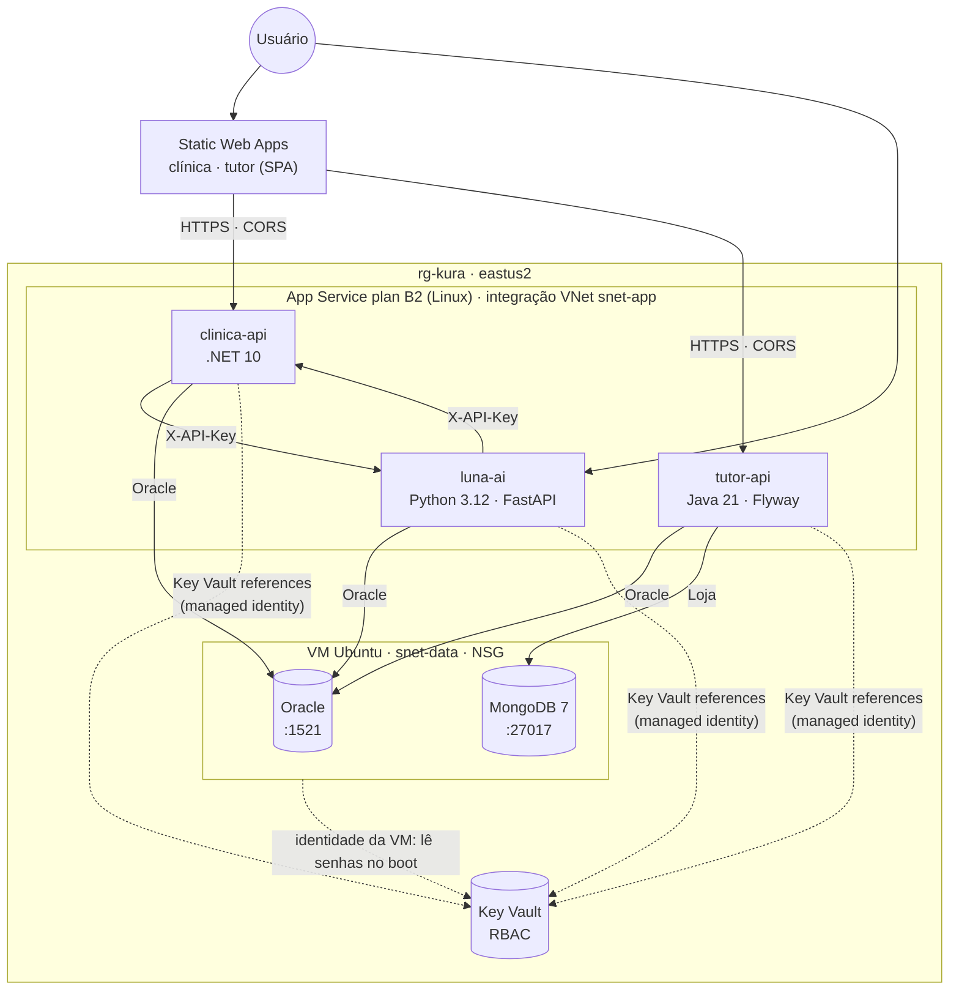
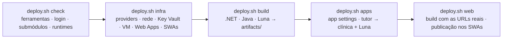

# Arquitetura — Kura no Azure

## Índice

- [Visão geral](#visão-geral)
- [Recursos](#recursos)
- [Rede e segurança](#rede-e-segurança)
- [Fluxo de deploy](#fluxo-de-deploy)
- [Persistência e limites](#persistência-e-limites)
- [Decisões](#decisões)
- [Validação do deploy.sh](#validação-do-deploysh)
- [Dívidas conhecidas](#dívidas-conhecidas-fora-do-escopo-desta-entrega)

## Visão geral

## Recursos

| Recurso | Nome / SKU | Função |
|---|---|---|
| Resource Group | `rg-kura` | Tudo em um grupo: `destroy` apaga o ambiente |
| VNet | `vnet-kura` `10.20.0.0/16` | `snet-app` (delegada a `Microsoft.Web/serverFarms`) e `snet-data` |
| NSG | `nsg-kura-data` na `snet-data` | Permite 1521 e 27017 **só** de `snet-app`; nega o resto. Sem SSH |
| VM | `vm-kura-db` · `Standard_B2ms` (8 GiB) · Ubuntu 24.04 | Docker + Oracle (+ MongoDB). IP público só para saída (`docker pull`, `apt`) |
| Key Vault | `kv-kura-<hash>` · RBAC | Segredos; papéis: *Secrets Officer* (quem implanta), *Secrets User* (Web Apps e VM) |
| App Service plan | `plan-kura` · Linux B2 | 3 Web Apps no mesmo plano |
| Web Apps | `kura-clinica-api`, `kura-tutor-api`, `kura-luna-ai` | Deploy de **código** (zip/jar), hostname único por tenant |
| Static Web Apps | `kura-clinica-web`, `kura-tutor-web` · Free | Web dos apps React Native |

## Rede e segurança

- **HTTPS em tudo** o que é público (`--https-only`, TLS mínimo 1.2, FTPS desligado, HTTP/2).
- **Banco fora da internet**: os Web Apps alcançam a VM pelo IP privado via integração de VNet; o NSG fecha o resto.
- **Sem credenciais de deploy**: credenciais básicas (FTP/SCM) desligadas; o deploy usa a identidade do `az login` (Entra ID).
- **Segredos só no Key Vault**: os Web Apps usam *Key Vault references* (identidade gerenciada); a VM lê as senhas
  do Oracle/Mongo no boot com a identidade dela e as grava em `/opt/kura/.env` (modo 600, só root).
- **CORS por lista explícita**: apenas os dois domínios dos Static Web Apps (mais `EXTRA_CORS_ORIGINS`).
- **Bundles web são públicos**: nenhuma chave em `EXPO_PUBLIC_*` no build web.

## Fluxo de deploy

Cada fase é um comando do `azure/deploy.sh`, executado de um terminal com `az login` (o passo a passo está no
[README](../README.md#passo-a-passo-do-deploy-inicial)). `deploy.sh all` roda o `check` e encadeia as quatro.

Ordem e dependências que o `deploy.sh` resolve:

1. **Hostnames antes dos app settings.** .NET e Luna precisam da URL um do outro; os 3 Web Apps (e os 2 SWAs) são criados
   primeiro e as URLs lidas com `az ... show`, então a dependência circular some.
2. **Tutor primeiro.** O Flyway (V1…) cria o schema Oracle quando o tutor sobe; .NET e Luna só sobem depois de ele ficar saudável.
3. **Web por último.** O `EXPO_PUBLIC_*` é embutido no JavaScript no `expo export`: o build precisa das URLs finais.
4. **Bootstrap da VM é verificado.** O `az vm run-command` não propaga o código de saída com confiança; o script da VM termina
   imprimindo uma sentinela e o `deploy.sh` falha se ela não aparecer (e se o Oracle/Mongo não responderem).

## Persistência e limites

- **Oracle** (XE 21c por padrão: 2 CPU, 2 GB de RAM, 12 GB de dados) e **MongoDB** usam *volumes nomeados* do Docker no disco da
  VM (64 GB). Sobrevivem a reinício do container e da VM; `destroy` os apaga. **Não há backup automático**
  (ver *snapshot* no README). O estado de demo se refaz com Flyway + seeds.
- **Receituários (PDF)** do .NET ficam em `/home/kura/receituarios` (o `/home` do App Service persiste).
- **Luna** roda com uma instância (o agendador APScheduler vive no processo). A imagem da Luna já é enxuta
  (`WITH_VISION=false`); a visão computacional (torch) não é implantada.

## Decisões

| Decisão | Motivo | Descartado |
|---|---|---|
| App Service com deploy de código | Menos peças, runtime com patch da plataforma, sem registry | ACR + ACI (restrição do projeto) |
| Oracle em container numa VM | Mantém Flyway/PL-SQL; App Service só expõe HTTP/S | Banco PaaS (perderia a infra Oracle) |
| `deploy.sh` com `az` explícito | A entrega exige mostrar os comandos Azure usados | Bicep/Terraform |
| Key Vault + RBAC + references | Segredo fora de repositório e de app settings em texto | Access policies (modelo legado), app settings em texto |
| VNet + NSG | Oracle/Mongo nunca ficam públicos | IP público com senha forte |
| Static Web Apps (SPA) | Gratuito, HTTPS, sem servidor; elimina nginx/proxy | Vercel + túnel (HTTP→HTTPS) |
| Deploy inicial por linha de comando | A entrega exige mostrar os comandos Azure; o ambiente é único e o Flyway migra o único banco | Pipeline de CD neste repositório (a pipeline do `tutor-api` fica no repositório do Java) |
| Submódulos com SHA fixado | O `build` compila uma versão reproduzível; rollback por commit | Sempre o `main` |
| Oracle XE 21c como padrão | Imagem já validada no projeto; nenhuma migration do tutor exige recurso do 23ai/26ai; o 26ai não consta como versão suportada na documentação do Flyway | Oracle 26ai Free (continua disponível por `ORACLE_IMAGE`/`ORACLE_SERVICE`) |
| MongoDB sempre provisionado | A Loja do tutor depende dele | Flag para desligar |
| Windows nativo pelo Git Bash, sem WSL | O mesmo `deploy.sh` roda em Windows, Linux e macOS: detecta o Git Bash, impede a conversão de caminhos, remove o CR da saída de `az` e do Python e corrige o próprio CRLF | Reescrever em PowerShell; WSL2 |
| Agente self-hosted Windows na pipeline do tutor | Mesma máquina do `deploy.sh`, sem WSL; os passos da pipeline usam cmd e PowerShell | Agente Linux (WSL2 ou VM) |

## Validação do deploy.sh

O que foi conferido antes da entrega, e o que só um deploy real prova:

| Conferido | Como |
|---|---|
| Todos os comandos `az` e suas opções | Contra o `--help` do Azure CLI 2.91 (comando existe, toda opção existe) |
| Valores aceitos de `--domain-name-scope`, `--application-logging`, `--docker-container-logging`, `--protocol` e `--type` (deploy) | No `--help` do mesmo CLI |
| Strings de runtime `JAVA:21-java21`, `PYTHON:3.12` e `DOTNETCORE:10.0` | Documentação da Microsoft e exemplos de uso em repositórios do Azure; o script ainda confere com `az webapp list-runtimes` e lista as opções se uma faltar |
| Nomes de variáveis, portas e health checks dos 3 serviços | Contra o código dos submódulos nos SHAs fixados (`/health`, `/api/actuator/health`, `DB_URL`, `SPRING_DATA_MONGODB_URI`…) |
| Fase `web` | Executada com os dois apps reais: `expo export` com as URLs embutidas, `app.json` ajustado para SPA e `preparar_dist` |
| Pacote da Luna | Gerado e listado (`src`, `requirements.txt`, `pyproject.toml`) |
| `scripts/db-select.sh` | `bash -n`, `shellcheck` e execução ponta a ponta com `az`, `curl` e `docker` simulados: aceita `select` e `with`, recusa DML, DDL e vários comandos, a senha não aparece na saída, o `sqlplus` recebe `set transaction read only;` e erros `ORA-` devolvem código 1 |
| Script de bootstrap da VM e compose embutido | Gerados, com `bash -n`, `shellcheck` e conferência estrutural do compose (job de CI) |
| Versão atual do `deploy.sh` (fases `check` e `seed`, registro de providers, escolha de VM, `maven_pronto`) | `bash -n`, `shellcheck`, comandos `az` novos contra o `--help`, uso e `check` executados em Linux, correção automática de um arquivo em CRLF e os passos do CI contra ele |
| Passos da pipeline do tutor (agente Windows) | Scripts PowerShell executados no PowerShell 7 com a lógica simulada (JDK, separação do `app.jar`, health check com 503 e depois 200) |

Não foi possível executar neste ambiente, e ficam para o primeiro deploy: tudo que exige uma subscription (criação de
recursos, referências do Key Vault, boot da VM, subida do Oracle e do Flyway), o `dotnet publish` (sem .NET SDK 10) e o
`mvnw package` (sem acesso ao Maven Central). O `db-select.sh` também não foi executado contra a VM real (o formato exato da mensagem do `az vm run-command` e o `sqlplus` do
container só são provados no ambiente). Também não foram executados, por falta de um Windows: os ramos do
`deploy.sh` específicos do Git Bash (`az.cmd`, `cygpath`, `--ssl-no-revoke`, conversão de caminhos) e o agente Windows da
pipeline; a lógica é a mesma validada em Linux, mas a primeira execução no Windows é a prova.

## Dívidas conhecidas (fora do escopo desta entrega)

- Sem ambiente de staging, slots de implantação, autoscale, backup automático nem observabilidade além do log do App Service.
- O app da clínica usa `web.output: static` no `app.json`; a fase `web` do `deploy.sh` força `single` (SPA) só no build. O ideal é mudar no repo do app.
- `.nvmrc` dos apps RN pede Node 20 (fim de vida); a fase `web` exige Node 20 ou superior e foi validada com o 22.
- O app mobile da clínica embute `EXPO_PUBLIC_LUNA_API_KEY` no pacote: o ideal é a Luna ser chamada via .NET.
- Spring Boot 3.2.5 (tutor) está fora do suporte da comunidade.
- Builds mobile (APK/IPA) ficam fora deste deploy; veja o `eas.json` nos repositórios dos apps, quando houver.
